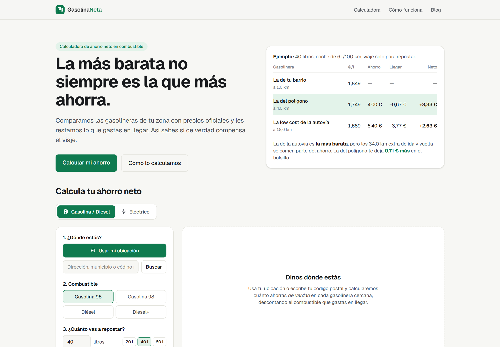

<div align="center">

# ⛽ GasolinaNeta

**La más barata no siempre es la que más ahorra**

Calculadora web que compara las gasolineras y los puntos de recarga cercanos por **ahorro neto**: lo que ahorras en el surtidor menos lo que gastas en llegar. Usa los precios oficiales del Ministerio y rutas reales por carretera.

[](https://gasolinaneta.vercel.app)




</div>

<details>
<summary>🇬🇧 <b>English summary</b></summary>

<br>

**GasolinaNeta** is a web calculator that ranks nearby petrol stations and EV chargers by **net savings**: the money saved at the pump minus the fuel spent driving there. It uses the official Spanish Ministry price API (11,000+ stations, updated every 30 minutes), the DGT open dataset of 12,000 EV charging sites, real road distances from OSRM and an interactive MapLibre map. The savings formula is a pure, tested function (Vitest), prices are cached in Supabase and refreshed by GitHub Actions and Vercel Cron. Validated with real data in 6 Spanish cities: in up to half of the scenarios, the cheapest station is **not** the one that saves you the most.

</details>

---

## 💡 La idea

Mucha gente cruza la ciudad para repostar en la gasolinera más barata sin pensar en el combustible que gasta en el camino. GasolinaNeta hace la cuenta completa: **precio en el surtidor − coste de ir y volver = ahorro real**. Con datos reales de 6 ciudades, en hasta la mitad de los escenarios la gasolinera más barata **no** es la que más ahorra.

## ✨ Funcionalidades

- 📍 **Ubicación o código postal** y radio de búsqueda; resultados en mapa interactivo y en lista.
- 🧮 **Ahorro neto por gasolinera**, con distancias y tiempos reales por carretera (OSRM).
- 🕒 **Horarios oficiales interpretados**: oculta las cerradas y avisa si cierran antes de que llegues.
- ⚡ **Modo eléctrico**: 12.038 puntos de recarga oficiales (DGT), precios verificados por operador y tiempo de carga según el coche.
- 🔄 **Precios siempre frescos**: el Ministerio publica cada 30 min y la app se actualiza cada ~10 min (GitHub Actions + Vercel Cron + caché en Supabase).
- ✅ **37 tests** de la fórmula, la normalización de datos y los horarios.

## 🛠️ Tecnologías

| Capa | Tecnología |
|---|---|
| Frontend | Next.js 16 (App Router), React, TypeScript, Tailwind CSS 4 |
| Mapa y rutas | MapLibre GL + OpenFreeMap, OSRM, Nominatim |
| Datos | API REST del Ministerio (carburantes), DGT DATEX II (recarga eléctrica) |
| Backend | Rutas API de Next.js, Supabase (PostgreSQL) como caché |
| Automatización | GitHub Actions y Vercel Cron |
| Calidad | Vitest, ESLint |

## 👤 Autor

**Diego Trascasa García** · [LinkedIn](https://www.linkedin.com/in/diego-trascasa-garc%C3%ADa-b171382b2/) · [GitHub](https://github.com/diegotraski)

---

# 📚 Documentación técnica

## Modo eléctrico

Selector "Gasolina / Diésel" ↔ "Eléctrico" encima de la calculadora (la ubicación se comparte).

- **Puntos de recarga**: dataset oficial del Punto de Acceso Nacional de la DGT, DATEX II v3, `https://nap.dgt.es/datex2/v3/miterd/EnergyInfrastructureTablePublication/electrolineras.xml`. Verificado el 05/10/2026: ~83 MB, 12.038 emplazamientos, licencia CC BY, publicación diaria. Trae operador, coordenadas, dirección, horario (relleno en 5.634), conectores (Tipo 2, CCS, CHAdeMO, Schuko…) y potencia. **No trae precios ni ocupación en tiempo real** (no existe esa capa en el NAP a esta fecha). Lector propio en `src/lib/ev/datex.ts` (~250 ms para todo el fichero).
- **Precios**: tabla curada a mano y versionada en `src/lib/ev/operatorPrices.ts`, solo con operadores cuyo precio sin suscripción aparece en **su propia web**, con URL y fecha. Verificados el 05/10/2026: Iberdrola | bp pulse, Repsol, Wenea, Zunder e IONITY (5.069 de 12.038 emplazamientos, 42 %). Endesa X Way (el mayor) **no publica tabla** (remite a su app y el precio depende de la hora) y las fuentes de prensa se contradicen, así que, igual que el resto de operadores, usa el **precio genérico** = mediana de los verificados por velocidad (lenta 0,39 €, rápida 0,59 €, ultrarrápida 0,59 €/kWh). La interfaz dice siempre si el precio es del operador o genérico.
- **Revisión de precios**: un test falla si algún precio lleva más de 60 días sin revisar (`npm test`). Para actualizar: abre cada URL de la tabla, cambia el precio y `checkedOn`.
- **Fórmula** (`src/lib/ev/evSavings.ts`, función pura con tests): ahorro neto en € y minutos extra **por separado**, nunca combinados. Tiempo de carga con la potencia mínima entre punto y coche; en DC × 0,75 por la curva de carga (aproximación documentada en /como-funciona).
- **Caché**: tabla `ev_snapshots` (Supabase) o `.cache/ev_snapshots.json`. El cron solo la descarga si tiene más de 6 h.
- **Spec vs. implementación**: el spec proponía las tablas `puntos_recarga` y `precios_operadores_referencia`. Los puntos van en `ev_snapshots` (misma estrategia que los precios de carburantes: una foto completa por descarga). Los precios de referencia viven en el código en lugar de una tabla: así cada cambio queda revisado en git con su fuente, y un test avisa cuando caducan.
- **Open Charge Map**: no integrado. Desde 2023 su API exige clave y, con 12.000 emplazamientos oficiales, aporta poco; sus precios colaborativos tampoco son fiables. Se puede añadir más adelante con `OCM_API_KEY`.

## Puesta en marcha en local

```bash
npm install
npm run dev
```

Abre http://localhost:3000. **No hace falta configurar nada**: sin Supabase, el servidor descarga los precios del Ministerio la primera vez y los guarda en `.cache/fuel-snapshot.json` (se refrescan solos en cuanto tienen más de 30 min).

`npm install` / `npm run dev` / `npm run build` copian el worker de MapLibre a `public/maplibre/<versión>/` (`scripts/copy-maplibre-worker.mjs`): MapLibre v6 lo carga con `new URL(..., import.meta.url)`, que el bundler de Next no resuelve.

| Comando | Qué hace |
| --- | --- |
| `npm test` | Tests de la fórmula y de la normalización de datos (Vitest) |
| `npm run fase0` | Valida la fórmula con datos reales en 6 ciudades (ver abajo) |
| `npm run lint` | ESLint |
| `npm run build` | Build de producción |

## Estructura

```
src/lib/netSavings.ts      La fórmula "¿compensa o no?" (función pura, testeada)
src/lib/ministry.ts        Descarga y normalización de la API oficial (esquema verificado)
src/lib/store.ts           Caché en 3 niveles: memoria → Supabase → fichero local
src/lib/nearby.ts          Búsqueda por radio
src/lib/hours.ts           Interpreta los horarios del Ministerio (abierta / cierra pronto / cerrada)
src/lib/routing.ts         Distancias y rutas reales por carretera (OSRM), con caché
src/lib/snapshotStore.ts   Caché genérica (memoria → Supabase → fichero) usada por carburantes y recarga
src/lib/ev/                Modo eléctrico: lector DATEX II, precios por operador, fórmula, perfiles de coche
src/app/api/ev/stations    POST {lat, lon, radius} → puntos de recarga cercanos
src/app/api/routes         POST {origin, destinations[]} → km y minutos por carretera
src/app/api/route          POST {from, to} → trazado de la ruta para el mapa
src/app/api/stations       POST {lat, lon, fuel, radius} → gasolineras cercanas
src/app/api/geocode        POST {q} → coordenadas (Nominatim; CP con respaldo local)
src/app/api/cron/refresh   Refresco de precios (protegido con CRON_SECRET)
src/components/calculator  Formulario, resumen, mapa (MapLibre), tarjeta flotante y lista
src/components/consent.tsx Banner de cookies + Consent Mode v2 + carga de AdSense/analítica
src/content/posts.tsx      Los 6 artículos del blog
scripts/fase0.ts           Validación con datos reales
supabase/schema.sql        Tabla de la caché
```

## La fuente de datos (verificada)

`GET https://sedeaplicaciones.minetur.gob.es/ServiciosRESTCarburantes/PreciosCarburantes/EstacionesTerrestres/`

Verificado con una llamada real el 05/10/2026: sin clave, ~12 MB de JSON, 11.478 estaciones. Campos usados: `IDEESS`, `Rótulo`, `Dirección`, `Localidad`, `Municipio`, `Provincia`, `C.P.`, `Latitud`, `Longitud (WGS84)`, `Horario`, `Tipo Venta`, y los precios `Precio Gasolina 95 E5`, `Precio Gasolina 98 E5`, `Precio Gasoleo A`, `Precio Gasoleo Premium`. Los decimales vienen con coma (`"1,749"`) y se convierten al normalizar. La propia API indica que los precios se actualizan **cada media hora**.

Se descartan estaciones de venta restringida (`Tipo Venta` ≠ `P`), sin coordenadas o sin precios válidos.

## Fase 0: validación con datos reales

```bash
npm run fase0                                    # 6 ciudades, gasolina 95, 40 l, 6 l/100 km, 15 km
npm run fase0 -- --at 40.4168,-3.7038 --liters 20 --consumption 8 --radius 30
```

Resultados del 05/10/2026 (en cuántas de las 6 ciudades la más barata **no** es la que más ahorra):

| Escenario | Difieren |
| --- | --- |
| G95, 40 l, 6 l/100 km, 15 km | 1/6 |
| G95, 40 l, 6 l/100 km, 30 km | 2/6 |
| G95, 20 l, 8 l/100 km, 30 km | 3/6 |
| Diésel, 40 l, 6 l/100 km, 30 km | 3/6 |

El caso más llamativo: desde Sol (Madrid), con 20 l y radio 30 km, la más barata (1,549 €/l) deja **−4,47 €** netos. El detalle está en el artículo del blog "Analizamos 6 ciudades".

## Despliegue en Vercel

1. **Supabase**: crea un proyecto y ejecuta `supabase/schema.sql` en el SQL Editor.
2. **Vercel**: importa el repo y define las variables de `.env.example`. Como mínimo: `NEXT_PUBLIC_SITE_URL`, `SUPABASE_URL`, `SUPABASE_SERVICE_ROLE_KEY` y `CRON_SECRET` (una cadena aleatoria larga).
3. Tras el primer despliegue, carga los precios por primera vez:
   ```bash
   curl -H "Authorization: Bearer $CRON_SECRET" https://TU-DOMINIO/api/cron/refresh
   ```

### Frescura de los precios (lo más rápido posible)

El Ministerio publica precios nuevos **cada media hora**. Hay cuatro capas para que nunca vayamos muy por detrás:

1. **GitHub Actions cada 10 min** (`.github/workflows/refresh-prices.yml`, gratis): llama a `/api/cron/refresh` aunque nadie visite la web. Configura en el repo el secret `CRON_SECRET` y la variable `SITE_URL`. Es la pieza principal.
2. **Refresco en segundo plano en el servidor**: si un usuario pide precios con más de 30 min, se le sirven al instante y se descargan los nuevos tras la respuesta (`after()`). Si tienen más de 6 h, se descargan antes de responder.
3. **El navegador** vuelve a pedir precios cada 10 min si la pestaña está visible, y a los 20 s si el servidor le dio datos de más de 30 min (para recoger los recién descargados). Hay botón "Actualizar" e indicador de antigüedad.
4. **Vercel Cron** diario (`vercel.json`) como red de seguridad: el plan Hobby solo permite uno al día. Con Pro puedes ponerlo en `*/10 * * * *` y prescindir de GitHub Actions.

Retraso máximo típico frente al Ministerio: ~10 min (más los minutos que GitHub retrase la ejecución en horas punta). Se guardan solo las 3 copias más recientes en Supabase (cada una ~2-3 MB en `jsonb`).

### Rutas reales (OSRM)

Por defecto se usa el servidor público de demostración de OSRM (`router.project-osrm.org`), limitado a ~1 petición/s desde nuestro servidor y con caché de 24 h. **Vale para lanzar, no para mucho tráfico**: su política no admite uso intensivo. Para producción, levanta tu propia instancia con el mapa de España (gratis, ~4-8 GB de RAM):

```bash
wget https://download.geofabrik.de/europe/spain-latest.osm.pbf
docker run -t -v "${PWD}:/data" ghcr.io/project-osrm/osrm-backend osrm-extract -p /opt/car.lua /data/spain-latest.osm.pbf
docker run -t -v "${PWD}:/data" ghcr.io/project-osrm/osrm-backend osrm-partition /data/spain-latest.osrm
docker run -t -v "${PWD}:/data" ghcr.io/project-osrm/osrm-backend osrm-customize /data/spain-latest.osrm
docker run -t -p 5000:5000 -v "${PWD}:/data" ghcr.io/project-osrm/osrm-backend osrm-routed --algorithm mld --max-table-size 200 /data/spain-latest.osrm
```

y define `OSRM_URL=http://tu-servidor:5000`. Si OSRM no responde, la web sigue funcionando con distancias estimadas (marcadas con «≈»).

## AdSense y cookies

- Hasta que no definas `NEXT_PUBLIC_ADSENSE_CLIENT` no se carga nada de Google y **no aparece banner** (no hay cookies que consentir; Plausible no usa cookies).
- Al definirlo: se añade la meta de verificación, `/ads.txt` se genera solo, Consent Mode v2 arranca en "denied" y aparece el banner (Aceptar / Rechazar / Configurar, con el mismo peso visual).
- **Importante para la UE**: Google exige un CMP certificado por Google (IAB TCF) para servir anuncios en el EEE. El banner propio es correcto para no cargar nada sin consentimiento, pero para monetizar de verdad activa el mensaje de Google en AdSense → *Privacidad y mensajes → Normativas europeas* y pon `NEXT_PUBLIC_USE_GOOGLE_CMP=true`: el CMP de Google gestiona los anuncios y el banner propio queda solo para Google Analytics (si lo usas).
- Los huecos de anuncio (`<AdSlot>`) están entre bloques editoriales y al final de los artículos; nunca encima del mapa ni de los resultados. Necesitan los IDs `NEXT_PUBLIC_ADSENSE_SLOT_*`.

## Antes de publicar

- [ ] Rellena los datos marcados en amarillo en `/aviso-legal`, `/privacidad` y `/cookies` (titular, NIF, domicilio, email, analítica elegida) y haz revisar los textos.
- [ ] Define `NEXT_PUBLIC_SITE_URL` con tu dominio (sitemap, canonical y User-Agent de Nominatim).
- [ ] Mapa: OpenFreeMap (gratis, sin clave, uso comercial permitido; atribución bajo el mapa). Si algún día necesitas garantías de servicio, puedes autoalojar sus teselas o cambiar `STYLE_LIGHT`/`STYLE_DARK` en `StationMap.tsx`.
- [ ] Rutas: pasa a una instancia propia de OSRM antes de tener tráfico (ver arriba).
- [ ] Geocodificación: Nominatim público admite ~1 petición/s. Con tráfico alto, usa un proveedor o una instancia propia.

## Métricas (sección 11 del brief)

Con `NEXT_PUBLIC_PLAUSIBLE_DOMAIN` definido se envía el evento `Resultado` con la propiedad `difiere: si|no` cada vez que alguien ve resultados. Es la métrica para saber si el diferenciador aparece con suficiente frecuencia.

## Exactitud: qué está resuelto y qué no

- ✅ Distancias y tiempos reales por carretera (OSRM) para las gasolineras que deciden el resultado; la referencia se elige por carretera.
- ✅ Horarios: el 95,7 % de los horarios oficiales se interpretan (datos del 05/10/2026); los ambiguos se muestran como "sin confirmar". Las cerradas se ocultan por defecto y se avisa si cierran antes de que llegues. Hora de Canarias incluida.
- ✅ Ubicación GPS de alta precisión (redondeada a ~10 m al enviarla).
- ⏳ Vuelta = mismo recorrido que la ida (en calles de sentido único puede variar algo).
- ⏳ Modo "de camino": el desvío real sobre tu ruta aún cuenta como 0.

## Fase 2 (pendiente)

- Desvío real sobre ruta para el modo "de camino" (OSRM con origen, gasolinera y destino).
- Más contenido SEO centrado en el ángulo "¿compensa?".
- Plan sin anuncios (fase 3), solo si hay tracción.
